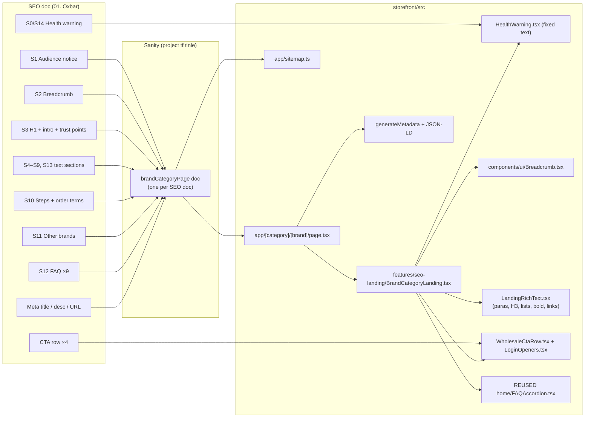

# SEO Content Map — Brand × Category Landing Pages

Source doc: [01. Oxbar-Disposables-Gemini.docx](https://docs.google.com/document/d/1xOyC3PWnI4NAHeYpblZ5a2i9lFG3dAu1/edit) (SEO team, Oct 2026)

Status (2026-10-20): **code built, Oxbar content seeded into Sanity (tflrlnle / production), page proof-read on localhost. Not committed, not deployed** — the live site won't show the page until the code is deployed.

This file maps the SEO team's content onto the storefront: what goes where, what was built and what's still pending.

---

## 1. What the doc actually is

- It is **one new landing page**: "Oxbar Disposables" at URL `/disposables/oxbar/`.
- It is **not** a product page and **not** a change to the homepage. The doc says so itself: *"This page covers Oxbar disposables as a category. Each device, flavour and strength is listed as its own product in our catalogue."*
- The file is numbered **"01."** → expect more docs in the same format (02, 03… likely one per brand: Geek Bar, Elf Bar, Kraze, etc. — the 10 brands listed in section S11). So we build **one reusable template**, then each new doc = new content only, no new code.
- The doc has two halves:
  - **Page content** — everything above the line *"END OF PAGE CONTENT. Everything below is not for publishing."*
  - **Not published** — Meta title / Meta description / URL (these go into SEO fields, not on screen) and the **fact-check sources** list (never shown on the site; keep only for our reference).

### Hard rules that come from the content itself (legal, not style)

| Rule | Why | What it means for us |
|---|---|---|
| Health warning at top **and** bottom, with "Health Canada" beside/below it | Vaping Products Promotion Regulations s.12 / s.22 | A dedicated warning component, exact text, not editable into something else |
| **No reviews / testimonials** on this page | TVPA s.30.21 bans promotion via testimonials | Do **not** reuse the homepage `Testimonials` section here |
| "Last reviewed: October 2026" line under the provincial rules | Rules change; date must be honest | Kept as normal body text in Sanity (editable, in the doc's exact position), not hardcoded |
| Audience notice ("registered businesses and adults of legal age") | Ads must not be seen by young persons | Show near the top; the existing `ProvinceGateModal` still runs sitewide |

---

## 2. Page structure — section by section

IDs (S0, S1…) are used in the rest of this file.

| ID | Section (heading in doc) | Content type | Count |
|---|---|---|---|
| S0 | Health warning (top) | Fixed legal text | 1 line |
| S1 | Audience notice | 1 sentence | 1 |
| S2 | Breadcrumb `Home / Disposables / Oxbar` | Nav | 3 crumbs |
| S3 | **H1:** Wholesale Oxbar Disposables in Canada From Gemini Distribution | 2 paragraphs + CTA row + 4 trust bullets | 4 bullets |
| S4 | **H2:** Why Customers Ask for Oxbar | Intro para (with link to oxbar.com) + 5 bold-lead bullets + closing line with Log in link | 5 |
| S5 | **H2:** What the Oxbar Range Looks Like | Intro + **3 × H3** (Large Capacity… / Power Modes… / Flavours and Nicotine) + CTA line | 3 sub-blocks |
| S6 | **H2:** Who Buys It and Where It Fits | Intro + 3 bullets + "shelf positioning" paragraph naming Kraze, Instabar, Orbito, Drip'n | 3 |
| S7 | **H2:** Provincial Rules for Selling Oxbar | Intro + 5 bold-lead rules + excise-stamp paragraph (2 legal links) + "Last reviewed" + email CTA | 5 rules |
| S8 | **H2:** Tips for Your First Oxbar Order | 4 bold-lead tips + Apply CTA line | 4 |
| S9 | **H2:** Why Stores Buy Oxbar From Us at Gemini | 8 bold-lead benefits (one links to /products) | 8 |
| — | CTA row (repeat #2) | Sign-Up / Apply / Log In | — |
| S10 | **H2:** Open a Gemini Account to Order Oxbar | 4 numbered steps + "Order terms" paragraph | 4 steps |
| — | CTA row (repeat #3) | Sign-Up / Apply / Log In | — |
| S11 | **H2:** Stock More Than Oxbar on One Gemini Account | 10 brand names + link to /brands + address + email | 10 brands |
| S12 | **H2:** Oxbar Wholesale FAQs | 9 Q&A + "Email our team" line | 9 |
| S13 | **H2:** Put Oxbar on Your Shelf | Closing paragraph + CTA row (repeat #4) | — |
| S14 | Health warning (bottom) | Same as S0 | 1 line |

### SEO fields (not shown on page)

| Field | Value from doc | Note |
|---|---|---|
| Meta title | `Oxbar Disposables Wholesale Canada \| Gemini Distribution` | Our root layout has `template: "%s \| Gemini Distribution"` → would print the brand **twice**. Must use `title: { absolute: ... }` |
| Meta description | `Buy genuine Oxbar disposable vapes in bulk from Gemini Distribution, an authorized Canadian distributor, stamped for every province and territory.` | 148 chars, fine |
| URL | `/disposables/oxbar/` | Next.js here has no `trailingSlash` → real URL becomes `/disposables/oxbar`. Canonical should be that. **Confirm with SEO team** that no trailing slash is OK |

### Links inside the content (all must work)

| Text in doc | Doc target | Our target |
|---|---|---|
| Wholesale Sign-Up Form / Apply for Account / apply now | `geminidistribution.ca/apply` | `/apply` (exists — `src/app/apply/page.tsx`, already has Retailer / Wholesale / Google sign-up) |
| Log In | `#` (placeholder) | Open existing login modal (`LoginTrigger` / `LoginModalProvider`) — not a page link |
| catalogue | `/products` | `/products` (exists) |
| Brands page | `/brands` | `/brands` (exists) |
| Email our team | `mailto:geminidistribution08@gmail.com` | same |
| Oxbar | oxbar.com | external, `target="_blank" rel="noopener"` |
| 20 mg/mL, vaping excise stamp, Tobacco and Vaping Products Act | gov.ca / laws-lois links | external, same as above |

The CTA row appears **4 times** (after S3, S9, S10, S13). Build it once as a component.

---

## 3. Map — doc → storefront (as built)

All paths below are inside `storefront/` (its own git repo).



### Where each piece lives

| Doc section | What renders it | File |
|---|---|---|
| Route `/<category>/<brand>` | Page + 404 if no Sanity doc | `src/app/[category]/[brand]/page.tsx` |
| Content | Sanity doc type `brandCategoryPage` + 4 section types | `src/sanity/schemaTypes/brandCategoryPage.ts` (registered in `schemaTypes/index.ts`) |
| Fetching | `getBrandCategoryPage()`, `listBrandCategoryPages()` — cached weekly, never throw, keep last good copy | `src/lib/sanity/brand-category-page.ts` |
| Page layout (all sections in order) | `BrandCategoryLanding` | `src/features/seo-landing/BrandCategoryLanding.tsx` |
| S0 / S14 warning | `HealthWarning` — fixed legal text, not editable | `src/features/seo-landing/HealthWarning.tsx` |
| S1 audience notice | Sanity field `audienceNotice` | (in `BrandCategoryLanding`) |
| S2 breadcrumb | `Breadcrumb` (new shared component) | `src/components/ui/Breadcrumb.tsx` |
| S3 hero | H1 + intro + CTA row + trust points | (in `BrandCategoryLanding`) |
| S4–S9, S13 | `landingRichSection` → `LandingRichText` (list or card layout) | `src/features/seo-landing/LandingRichText.tsx` |
| CTA row ×4 | `WholesaleCtaRow` (Sign-Up + Apply → `/apply`, Log In → popup; Log In hidden for approved users). Shown after any section with "Show buttons after" ticked | `src/features/seo-landing/WholesaleCtaRow.tsx` |
| "Log In" / "Log in" links (`#` in doc) | Stored as `#login`, opens login popup; approved users go to `/products` instead | `src/features/seo-landing/LoginOpeners.tsx` |
| S10 steps | `landingStepsSection` (4 numbered cards + order terms box) | (in `BrandCategoryLanding`) |
| S11 other brands | `landingBrandListSection` (text chips, no links yet — D6) | (in `BrandCategoryLanding`) |
| S12 FAQ | `landingFaqSection` → **reused** `FAQAccordion` (answers stay in the HTML when closed, so Google can read them) | `src/features/home/components/FAQAccordion.tsx` |
| Meta | `title: { absolute }` (no double brand name), description, canonical, Open Graph | `page.tsx` |
| Structured data | `BreadcrumbList` + `FAQPage` JSON-LD (`<` escaped) | `page.tsx` |
| Sitemap | Landing pages added from Sanity; Sanity failure only drops these entries | `src/app/sitemap.ts` |
| Cache refresh on publish | New tag `sanity:brand-category-pages` | `src/app/api/webhooks/sanity/route.ts` |
| Oxbar content (word for word) | Seed data + markdown→Portable Text helper | `scripts/sanity/oxbar-disposables-content.ts`, `scripts/sanity/seed-oxbar-disposables.ts` |

### Sanity schema as built (`brandCategoryPage`)

```
brandCategoryPage
├─ title                     internal name, e.g. "01. Oxbar Disposables"
├─ categorySlug / brandSlug  "disposables" / "oxbar"  (lowercase-with-dashes enforced)
├─ metaTitle / metaDescription
├─ audienceNotice            S1
├─ breadcrumbCategoryLabel   "Disposables"
├─ breadcrumbCategoryUrl     "/products?category=vapes&subcategory=disposable-vapes"
├─ breadcrumbCurrentLabel    "Oxbar"
├─ h1, heroIntro (rich text), trustBullets[]
└─ sections[]  (any order, any mix)
   ├─ landingRichSection      heading, body (rich text), listLayout list|cards, ctaRowAfter
   ├─ landingStepsSection     heading, steps[{title, body}], afterSteps, ctaRowAfter
   ├─ landingBrandListSection heading, intro, brands[], outro, ctaRowAfter
   └─ landingFaqSection       heading, items[{question, answer}], outro, ctaRowAfter
```

Rich-text links accept: `/site-path`, `https://…` (opens in a new tab), `mailto:…`, or `#login`.

Not fields on purpose: the health warning and the CTA button labels. They're the same on every page, so no single page can end up with them edited or missing.

Oxbar section settings used: S7 rules and S9 benefits use the **cards** layout. Buttons appear after S9, S10 and S13 (plus the hero), which matches the doc's 4 CTA rows.

---

## 4. Responsiveness (as built, verified)

| Area | Mobile (<640px) | Tablet (sm 640+) | Desktop (lg 1024+) |
|---|---|---|---|
| Page wrapper | `px-4` (16px gutter) | `px-6` | `max-w-310` centered |
| Reading column | full width | `max-w-[52rem]` | `max-w-[52rem]` (~75 chars per line) |
| H1 | `text-3xl` | `text-4xl` | 49px (site H1 token) |
| Health warning | full-width box, text wraps | same | same |
| Breadcrumb | wraps onto 2 lines if needed | — | — |
| CTA row (3 buttons) | **stacked, full width**, 50px tall | row | row |
| Hero trust points (4) | 1 column | 2 columns | 4 columns |
| Card lists (S7, S9) | 1 column | 2 columns | 2 columns |
| Plain lists (S4, S6, S8) | bullet list | same | same |
| S5 H3 blocks | stacked inside the reading column (kept as prose, not 3 columns — the paragraphs are too long for narrow columns) | same | same |
| S10 steps (4) | 1 column | 2×2 | 2×2 |
| S11 brand chips | 2 columns | 3 columns | 4 columns |
| S12 FAQ | reused accordion (already responsive) | — | — |
| Long links / email | `break-words` | — | — |

**Verified with Playwright (2026-10-20)** at 360, 390, 768, 1024 and 1440 px, using the full Oxbar content:
- No element of the page goes past the screen edge at any width.
- 1 H1 and 10 H2s, in the doc's order.
- Log In button and inline "Log in" link both open the login popup; FAQ opens and closes.
- `/disposables/oxbar/` → 308 redirect to `/disposables/oxbar` (Next's default, no config needed).
- `/brands/foo` and `/wp-admin/setup.php` → 404; `/products` unaffected.

**Already broken elsewhere on the site, not caused by this page:** at exactly 1024px the whole site scrolls sideways to 1333px. It comes from the Navbar (desktop nav + right-side actions) and the TopBar marquee, and it happens the same way on `/brands` and `/privacy`. Worth a separate fix.

Rule followed: no `max-w-md / lg / xl` (they collapse to tiny px values in this storefront).

---

## 5. Decisions

| # | Question | Decision |
|---|---|---|
| D1 | Route shape. Will future pages all be `/disposables/<brand>`, or also e.g. `/e-liquids/<brand>`? | **What the doc says:** only one URL (`/disposables/oxbar/`). Breadcrumb `Home / Disposables / Oxbar` confirms a category/brand shape. The 10 "other brands" in S11 are all disposable brands → next docs are probably `/disposables/<brand>`. Oxbar pods/e-juices are mentioned but get no URL. **Other categories: not stated.** → **Built** `app/[category]/[brand]/page.tsx`, driven by Sanity, so either answer works with zero code changes. Any pair without a Sanity doc → 404. |
| D2 | Trailing slash `/disposables/oxbar/` vs `/disposables/oxbar` | **What the doc says:** the page URL has a slash, but every other link in the same doc has none (`/apply`, `/products`, `/brands`). → **Built:** no slash; Next already 308-redirects the slash version; canonical has no slash. |
| D3 | Breadcrumb "Disposables" link — no `/disposables` page exists | **What the doc says:** plain text, no links. **Codebase:** static data had two different names (`Disposable`, `Disposable Vapes`). **Live Shopify taxonomy (checked 2026-10-20):** category `Vapes` (id `vapes`), sub-category `Disposable Vapes` (id `disposable-vapes`). → **Built:** "Disposables" links to `/products?category=vapes&subcategory=disposable-vapes` (editable in Sanity). |
| D4 | Health warning — not on any other page of the site | **What the doc says:** top and bottom of *this* page, citing the Vaping Products Promotion Regulations (s.12, s.22). → **Built** on landing pages only. Sitewide is the client's call (question 3 below). |
| D5 | Live Oxbar product grid? | **What the doc says:** products are ordered in the catalogue; the page only pushes log in / apply. → **Not added.** |
| D6 | Link the S11 brand names? | **What the doc says:** plain text. → **Built** as plain text chips. Link each one once its own landing page exists. |
| D7 | Footer "Brands → Oxbar" is `href="#"` | Not in the doc → follow-up after launch. |
| D8 | Indexing | Not in the doc. `robots.ts` + `layout.tsx` block all indexing (pre-launch) → left as is. The page has correct meta, canonical and sitemap entry, ready for when indexing is switched on. |

### Questions for the SEO team

1. Will the next docs only cover disposable brands, or also other categories (e-liquids, pods)? *(D1 — the build handles both)*
2. Is `/disposables/oxbar` (no trailing slash) OK? The rest of the site, and the other links in your own doc, use no slash. *(D2)*

### Question for the client

3. Should the Health Canada warning go on every page of the site, or only on these landing pages? *(D4)*

### Follow-ups after the page is live (not part of this build)

- Footer "Oxbar" link → new page *(D7)*
- Link the S11 brand names once their landing pages exist *(D6)*
- Lift the sitewide noindex at launch *(D8)*
- Separate bug: sitewide sideways scroll at 1024px (Navbar/TopBar), see section 4

---

## 6. Build status

| # | Step | Status |
|---|---|---|
| 1 | Sanity schema + register | ✅ Done (Studio is embedded at `/studio`, so it ships with the next deploy) |
| 2 | Oxbar content into Sanity | ✅ Seeded 2026-10-20 — doc id `brandCategoryPage-disposables-oxbar`, published |
| 3 | Fetcher | ✅ Done |
| 4 | Shared components (warning, breadcrumb, CTA row, rich text) | ✅ Done |
| 5 | Page sections (hero, text, steps, brands, FAQ) | ✅ Done |
| 6 | Route + metadata + JSON-LD | ✅ Done |
| 7 | Sitemap + webhook tag | ✅ Done |
| 8 | Responsive check (5 widths) | ✅ Done with the seed content via a temporary local preview route (removed afterwards) |
| 9 | Proof-read the page against the doc | ✅ Done on localhost (details below) |
| — | `tsc --noEmit` + eslint on new files | ✅ Clean |
| — | Sanity webhook filter | ✅ Done 2026-10-20 — "crud" webhook filter is now `_type in ["page","collectionBanner","pageBanner","productPageContent","topBar","brandCategoryPage"]` (`topBar` was also missing before) |
| — | Commit / deploy | ⏳ Not done |

**Proof-read result (2026-10-20, `localhost:3000/disposables/oxbar` with the real Sanity content):**
- All 99 content lines of the doc are on the page word for word, 0 missing.
- Headings: 1 H1, 10 H2, 16 H3 (3 range sub-headings + 4 steps + 9 FAQ questions).
- Health warning top + bottom; 4 CTA rows; 2 inline "Log in" links open the popup.
- All 14 links point where the doc says (geminidistribution.ca links → site paths; external links open in a new tab).
- Title `Oxbar Disposables Wholesale Canada | Gemini Distribution` (no double brand name), meta description exact, canonical `https://www.geminidistribution.ca/disposables/oxbar`.
- JSON-LD: BreadcrumbList (3 crumbs) + FAQPage (9 questions).
- In `/sitemap.xml`.
- `robots: noindex, nofollow` — expected, sitewide pre-launch block (D8).

---

## 7. Checklist for each new SEO doc (02, 03, …)

- [ ] Read the doc; confirm it fits the 4 section types. If a new kind of section appears, update the schema and this file first.
- [ ] Take category + brand slug from the doc's `URL:` line (drop the trailing slash).
- [ ] Meta title / description go into the SEO fields, not onto the page.
- [ ] Ignore everything under "END OF PAGE CONTENT" except the meta block.
- [ ] Every "Log In" link (`#` in the doc) → `#login`; full geminidistribution.ca links → site paths (`/apply`, `/products`, `/brands`).
- [ ] Check the breadcrumb category link against the live taxonomy.
- [ ] Update the "Last reviewed" line (it's normal body text in the rules section).
- [ ] Tick "Show buttons after" on the sections the doc follows with a Sign-Up / Apply / Log In row.
- [ ] No testimonials or reviews anywhere on the page.
- [ ] Publish → page appears at `/<category>/<brand>` and in `/sitemap.xml`.
- [ ] Mobile check at 360px.

Quickest way for a new doc: copy `scripts/sanity/oxbar-disposables-content.ts`, swap the text, and run a seed. Or fill the fields in Studio by hand.

---

## 8. How to put content live (Oxbar steps 1–4 done 2026-10-20)

1. In sanity.io/manage → project **tflrlnle** → API → Tokens, create a token with **Editor** rights.
2. Add it to `storefront/.env.local` as `SANITY_WRITE_TOKEN=...` (never commit it, never put it in Vercel).
3. Run from `storefront/`:
   `npx tsx --env-file=.env.local scripts/sanity/seed-oxbar-disposables.ts`
   This creates the doc as **published**. It won't overwrite it if it already exists.
4. Open `http://localhost:3000/disposables/oxbar` and proof-read it against the doc.
5. Add `"brandCategoryPage"` to the Sanity webhook filter. ✅ Done once; future SEO pages use the same type, so nothing to add.
6. Deploy (client's Vercel team).
