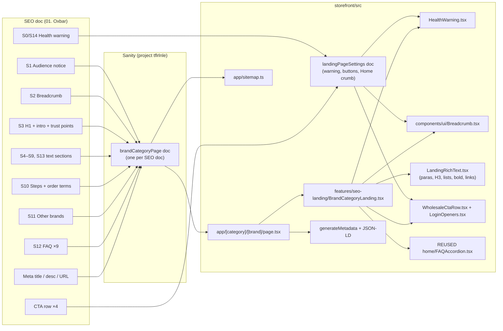

# SEO Content Map — Brand × Category Landing Pages

This file maps the SEO team's content onto the storefront: what goes where, what was built and what's still pending.

---

## 0. Doc tracker (updated 2026-10-24)

### Docs received

| # | Doc | URL | Status |
|---|---|---|---|
| 01 | *(first batch: "01. Oxbar")* — [old doc](https://docs.google.com/document/d/1xOyC3PWnI4NAHeYpblZ5a2i9lFG3dAu1/edit) | /disposables/oxbar | Replaced by doc 02. Live 2026-10-20 → 2026-10-24 and approved by the SEO team; their only feedback was to **remove the office address** |
| 02 | [02__Oxbar-Disposables-Gemini](https://docs.google.com/document/d/1EqX-93QU9ccnLW8XTf0sJE5rlQFINzgeK6F3uBoUDsc/edit) | /disposables/oxbar | ✅ **Live 2026-10-24**. Replaces the 01 content in full (client decision) |
| 03 | [03__Flavour-Beast-Disposables-Gemini](https://docs.google.com/document/d/1IZkxAKfUiuw5vf5hMYKcGC6s4vXdqRmaxRm4lZKVEls/edit) | /disposables/flavour-beast | ✅ **Live 2026-10-24** |
| 04 | [04__Instabar-Disposables-Gemini](https://docs.google.com/document/d/106eZ-Dthq7-WZzsLyzK32AoLQgC9gWOwwUMn0JOapz8/edit) | /disposables/instabar | ✅ **Live 2026-10-24** |
| 05 | [05__Mr-Fog-Disposables-Gemini](https://docs.google.com/document/d/1mOTNP3aJo72GSBdKLZvy8mHZg3lEdO3MKDEGAoPkMpw/edit) | /disposables/mr-fog | ✅ **Live 2026-10-24** |
| 06 | [06__STLTH-Disposables-Gemini](https://docs.google.com/document/d/1MvSNasnm3rfvAO28B8b6QNcQNP7fScHD6JLs4vdSAn0/edit) | /disposables/stlth | ✅ **Live 2026-10-24** |
| 07 | [07__Kraze-Disposables-Gemini](https://docs.google.com/document/d/1x4LvYU9cr73M2IszyB1kIv1cr9OOC31AYtwn45uyzgk/edit) | /disposables/kraze | ✅ **Live 2026-10-24** |
| 08 | [08__Geek-Bar-Disposables-Gemini](https://docs.google.com/document/d/1C7jbwjt_7BgaPbTCpIkMs5vKEJmg3Gn0MsTvoWWwHZ8/edit) | /disposables/geek-bar | ✅ **Live 2026-10-24** |
| 09 | [09__Dripn-by-ENVI-Disposables-Gemini](https://docs.google.com/document/d/199qOSarQvP-tLMPq6Aqil4u2VDDEBoiWhWD5gPz7__s/edit) | /disposables/dripn-by-envi | ✅ **Live 2026-10-24** |
| 10 | [10__Ripper-Disposables-Gemini](https://docs.google.com/document/d/1zO266mSSV5It5LDVXsKPkACpoMil8llTiBazpTiGG8g/edit) | /disposables/ripper | ✅ **Live 2026-10-24** |
| 11 | [11__Elf-Bar-Disposables-Gemini](https://docs.google.com/document/d/1VipPBNjHKmAe9xz_yR-qEZwog6FZj3ewsqnBCZk-20s/edit) | /disposables/elf-bar | ✅ **Live 2026-10-24** |
| 12 | [12__Gcore-Disposables-Gemini](https://docs.google.com/document/d/114G49ApveSYbQtZbMBCkXBE5hJaZ_AllLtsIRsoxMlE/edit) | /disposables/gcore | ✅ **Live 2026-10-24** |
| 01 (new numbering) | ❌ not received | probably the /disposables hub (to confirm) | — |

Docs are matched to pages by the **URL slug and title inside each doc**, never by the number or link order they were sent with (the doc 07/08 links were first sent as copies of doc 06).

Code: storefront commit `88000f2` (the template, unchanged since). Content is written to Sanity with `seed-landing-pages.ts`. Proof-reading:
- **02–04 and 09–12:** an independent agent compared each Google Doc against the rendered localhost page. Result: 0 unexpected differences.
- **05–08:** the same check, run against the content files (low disk space ruled out a browser run). Result: 0 unexpected differences.
- **All 11 on production (2026-10-24):** every text piece in the content files appears on the live page (114 to 127 per page). Meta titles are correct, no page shows the address, and there are 3 CTA rows per page.
- **Responsive check:** no sideways scroll at 390px or 1440px. This was checked for the 7 pages verified in a browser; 05–08 use the same template.

Applied to every page: the **office address line is removed** (it appears as "Office:", "Our office:", "Find us at:", "Calgary office:", "Mailing address:" or "Office address:"). This was the SEO team's feedback on the approved Oxbar page. The address stays in the site footer.

### The 12 disposable brands the docs name

Each doc lists the page's own brand plus the same 11 others.

| # | Brand | URL | Doc | Page | Shopify brand name |
|---|---|---|---|---|---|
| 1 | Oxbar | /disposables/oxbar | 02 | ✅ | Oxbar |
| 2 | Flavour Beast | /disposables/flavour-beast | 03 | ✅ | Flavour Beast |
| 3 | Instabar | /disposables/instabar | 04 | ✅ | Instabar |
| 4 | Mr Fog | /disposables/mr-fog | 05 | ✅ | Mr Fog |
| 5 | STLTH | /disposables/stlth | 06 | ✅ | **Stlth** (case differs) |
| 6 | Kraze | /disposables/kraze | 07 | ✅ | Kraze |
| 7 | Geek Bar | /disposables/geek-bar | 08 | ✅ | Geek Bar |
| 8 | Drip'n by ENVI | /disposables/dripn-by-envi | 09 | ✅ | **Drip'n** (name differs) |
| 9 | Ripper | /disposables/ripper | 10 | ✅ | Ripper |
| 10 | Elf Bar | /disposables/elf-bar | 11 | ✅ | Elf Bar |
| 11 | Gcore | /disposables/gcore | 12 | ✅ | Gcore |
| 12 | Orbito | — | ❌ none | ❌ | Orbito |

**Orbito** is named in every doc's brand list, but no doc links to it, and no doc number is left free for it (02–12 are taken). Ask the SEO team whether a page is planned.

**Hub page `/disposables`:** every doc links to it 3 times ("disposables guide", "wholesale disposable vapes" page). ❌ No doc yet; probably doc 01.

**Links to pages that don't exist yet are not broken.** The link is saved in Sanity exactly as the doc has it, and the page shows it as plain text until that landing page is published. After that it becomes a link by itself, with no content edit (`isUnpublishedLandingPath` in `LandingRichText.tsx`). Now that all 11 brand pages are live, every brand link is active. Only `/disposables` is still plain text.

**Formatting notes:** Elf Bar and Geek Bar's ordering steps are numbered lists, not step cards, because their bold leads run into the sentence. Two-paragraph FAQ answers (Gcore, Kraze) show as one paragraph, since FAQ answers are plain text.

### Disposable brands in Shopify but in no doc

CAPSL, Dojo, Doozy Quad, ENVI x TasteFlex, Linvo, VFEEL, Vice. Ask the SEO team whether these get pages. Also, `ddddddd` and `dddssssss` (Disposable Vapes) and `dd` (Pre-Rolled Cones) are test brand entries in Shopify and should be deleted in the admin.

### Menu coverage (live Shopify menu, 2026-10-24)

```
Vape & e Juices
├── Disposable ........ 11 of 12 brand pages live; Orbito + hub missing   (this file)
├── E-Juices .......... 17 brands  ❌ no docs
├── Pre-Filled Pods ... Oxbar, Flavour Beast, Mr Fog, Ripper  ❌ no docs
├── Devices ........... ❌ no docs
└── Hardware .......... ❌ no docs
Smoking / Cannabis Accessories / Convenience ...  ❌ no docs
```

### What the docs say about the site (checked against the code)

| Claim in docs | True? |
|---|---|
| Province picker: BC is its own choice, not part of Federal | ✅ `src/lib/regions.ts` (Federal, BC, Alberta, Manitoba, Ontario, Quebec) |
| Picker doesn't show NS, NB, PEI or the territories (doc 03) | ✅ same list |
| Pick province + sign in → stock and price for your stamp | ✅ existing behaviour |
| /apply: Retailer, Wholesale or Google sign-up | ✅ `src/app/apply/page.tsx` |
| $1,000 minimum, free shipping over $1,500 | ⚠️ Not enforced anywhere in storefront code. Business policy, so confirm with the client |

---

## 0b. Brand logos batch from the SEO team (received 2026-10-31)

15 PNG files arrived over WhatsApp. So far only their file names have been seen, not the images. Each is matched below to the Brand entry in Shopify (live check 2026-10-31). A brand's logo shows in the mega menu, the homepage brand strip and the /brands page.

The rule for each file: match it to the Shopify Brand **by name**, never by file order. Two file names are spelled differently from Shopify: `instbar` is Instabar and `koil-killz` is Koil Killaz. Open each image before uploading it.

Done in 2 phases. Phase 1 covers the disposable brands, which have live SEO landing pages; Phase 2 covers the rest. This split is a proposal and can be changed.

### Phase 1: Disposable brands (10 files)

| File | Shopify brand | Logo live now? | Action | Status |
|---|---|---|---|---|
| gcore.png | Gcore | ❌ | Add | ⏳ |
| geek-bar.png | Geek Bar | ❌ | Add. ⚠️ The file is only 2 kB, so check its quality first | ⏳ |
| instbar.png | Instabar | ❌ | Add | ⏳ |
| orbito.png | Orbito | ❌ | Add (no SEO page) | ⏳ |
| ripper.png | Ripper | ❌ | Add | ⏳ |
| vfeel.png | VFEEL | ❌ | Add (no SEO page) | ⏳ |
| kraze.png | Kraze | ✅ | Replace or keep? | ❓ |
| mr-fog.png | Mr Fog | ✅ | Replace or keep? | ❓ |
| oxbar.png | Oxbar | ✅ | Replace or keep? | ❓ |
| stlth.png | Stlth | ✅ | Replace or keep? ⚠️ The file is only 4 kB | ❓ |

### Phase 2: E-liquid, device and unknown (5 files)

| File | Shopify brand | Category | Logo live now? | Action | Status |
|---|---|---|---|---|---|
| kapow.png | Kapow | E-Liquids | ❌ | Add | ⏳ |
| koil-killz.png | Koil Killaz | E-Liquids | ❌ | Add | ⏳ |
| lemon-drop.png | Lemon Drop | E-Liquids | ❌ | Add | ⏳ |
| vaporesso.png | Vaporesso | Devices / Hardware | ❌ | Add | ⏳ |
| level-x.png | ❓ **not in Shopify** | — | — | Ask what this is; the brand may need creating first | ❓ |

### Brands that have no logo and no file

The file list starts at "g", so it may have been cut off at the top. Ask whether files for these brands were sent:

- **Disposable:** CAPSL, Dojo, Doozy Quad, **Drip'n**, **Elf Bar**, ENVI x TasteFlex, Linvo, Vice. Drip'n and Elf Bar have live SEO pages.
- **E-Liquids:** Berry Drop, Delicious Drip E-Juice, Doozy, ElfLiq, Flavour Drop, Fruitbae, Naked, Rufpuf.
- **Devices / Hardware:** Battery, Caliburn.

Flavour Beast already has a logo. `ddddddd` and `dddssssss` have logos but are test entries that should be deleted.

### Open questions

1. Where do the actual files go? Download them to one folder.
2. Is the top of the file list (a–f) missing?
3. What is Level X?
4. Should the 4 existing logos (Kraze, Mr Fog, Oxbar, STLTH) be replaced?
5. Are these brand logos, or are they meant as the 2 hero images on the landing pages?

---

## 1. What the doc actually is (written for the first doc, 01. Oxbar — sections 1–4 describe that build)

- It is **one new landing page**: "Oxbar Disposables" at URL `/disposables/oxbar/`.
- It is **not** a product page and **not** a change to the homepage. The doc says so itself: *"This page covers Oxbar disposables as a category. Each device, flavour and strength is listed as its own product in our catalogue."*
- The file is numbered **"01."** → expect more docs in the same format (02, 03… likely one per brand: Geek Bar, Elf Bar, Kraze, etc. — the 10 brands listed in section S11). So we build **one reusable template**, then each new doc = new content only, no new code.
- The doc has two halves:
  - **Page content** — everything above the line *"END OF PAGE CONTENT. Everything below is not for publishing."*
  - **Not published** — Meta title / Meta description / URL (these go into SEO fields, not on screen) and the **fact-check sources** list (never shown on the site; keep only for our reference).

### Hard rules that come from the content itself (legal, not style)

| Rule | Why | What it means for us |
|---|---|---|
| Health warning at top **and** bottom, with "Health Canada" beside/below it | Vaping Products Promotion Regulations s.12 / s.22 | Text lives once in the shared Sanity `landingPageSettings` doc (required fields); the page refuses to render if it's missing, so it can never go out without the warning |
| **No reviews / testimonials** on this page | TVPA s.30.21 bans promotion via testimonials | Do **not** reuse the homepage `Testimonials` section here |
| "Last reviewed: October 2026" line under the provincial rules | Rules change; date must be honest | Kept as normal body text in Sanity (editable, in the doc's exact position), not hardcoded |
| Audience notice ("registered businesses and adults of legal age") | Ads must not be seen by young persons | Show near the top; the existing `ProvinceGateModal` still runs sitewide |

---

## 2. Page structure — section by section

IDs (S0, S1…) are used in the rest of this file.

| ID | Section (heading in doc) | Content type | Count |
|---|---|---|---|
| S0 | Health warning (top) | Legal text (shared Sanity settings) | 1 line |
| S1 | Audience notice | 1 sentence | 1 |
| S2 | Breadcrumb `Home / Disposables / Oxbar` | Nav | 3 crumbs |
| S3 | **H1:** Wholesale Oxbar Disposables in Canada From Gemini Distribution | 2 paragraphs + CTA row + 4 trust bullets | 4 bullets |
| S4 | **H2:** Why Customers Ask for Oxbar | Intro para (with link to oxbar.com) + 5 bold-lead bullets + closing line with Log in link | 5 |
| S5 | **H2:** What the Oxbar Range Looks Like | Intro + **3 × H3** (Large Capacity… / Power Modes… / Flavours and Nicotine) + CTA line | 3 sub-blocks |
| S6 | **H2:** Who Buys It and Where It Fits | Intro + 3 bullets + "shelf positioning" paragraph naming Kraze, Instabar, Orbito, Drip'n | 3 |
| S7 | **H2:** Provincial Rules for Selling Oxbar | Intro + 5 bold-lead rules + excise-stamp paragraph (2 legal links) + "Last reviewed" + email CTA | 5 rules |
| S8 | **H2:** Tips for Your First Oxbar Order | 4 bold-lead tips + Apply CTA line | 4 |
| S9 | **H2:** Why Stores Buy Oxbar From Us at Gemini | 8 bold-lead benefits (one links to /products) | 8 |
| — | CTA row (repeat #2) | Sign-Up / Apply / Log In | — |
| S10 | **H2:** Open a Gemini Account to Order Oxbar | 4 numbered steps + "Order terms" paragraph | 4 steps |
| — | CTA row (repeat #3) | Sign-Up / Apply / Log In | — |
| S11 | **H2:** Stock More Than Oxbar on One Gemini Account | 10 brand names + link to /brands + address + email | 10 brands |
| S12 | **H2:** Oxbar Wholesale FAQs | 9 Q&A + "Email our team" line | 9 |
| S13 | **H2:** Put Oxbar on Your Shelf | Closing paragraph + CTA row (repeat #4) | — |
| S14 | Health warning (bottom) | Same as S0 | 1 line |

### SEO fields (not shown on page)

| Field | Value from doc | Note |
|---|---|---|
| Meta title | `Oxbar Disposables Wholesale Canada \| Gemini Distribution` | Our root layout has `template: "%s \| Gemini Distribution"` → would print the brand **twice**. Must use `title: { absolute: ... }` |
| Meta description | `Buy genuine Oxbar disposable vapes in bulk from Gemini Distribution, an authorized Canadian distributor, stamped for every province and territory.` | 148 chars, fine |
| URL | `/disposables/oxbar/` | Next.js here has no `trailingSlash` → real URL becomes `/disposables/oxbar`. Canonical should be that. **Confirm with SEO team** that no trailing slash is OK |

### Links inside the content (all must work)

| Text in doc | Doc target | Our target |
|---|---|---|
| Wholesale Sign-Up Form / Apply for Account / apply now | `geminidistribution.ca/apply` | `/apply` (exists — `src/app/apply/page.tsx`, already has Retailer / Wholesale / Google sign-up) |
| Log In | `#` (placeholder) | Open existing login modal (`LoginTrigger` / `LoginModalProvider`) — not a page link |
| catalogue | `/products` | `/products` (exists) |
| Brands page | `/brands` | `/brands` (exists) |
| Email our team | `mailto:geminidistribution08@gmail.com` | same |
| Oxbar | oxbar.com | external, `target="_blank" rel="noopener"` |
| 20 mg/mL, vaping excise stamp, Tobacco and Vaping Products Act | gov.ca / laws-lois links | external, same as above |

The CTA row appears **4 times** (after S3, S9, S10, S13). Build it once as a component.

---

## 3. Map — doc → storefront (as built)

All paths below are inside `storefront/` (its own git repo).



### Where each piece lives

| Doc section | What renders it | File |
|---|---|---|
| Route `/<category>/<brand>` | Page + 404 if no Sanity doc | `src/app/[category]/[brand]/page.tsx` |
| Content | Sanity doc type `brandCategoryPage` + 4 section types | `src/sanity/schemaTypes/brandCategoryPage.ts` (registered in `schemaTypes/index.ts`) |
| Fetching | `getBrandCategoryPage()`, `listBrandCategoryPages()` — cached weekly, never throw, keep last good copy | `src/lib/sanity/brand-category-page.ts` |
| Page layout (all sections in order) | `BrandCategoryLanding` | `src/features/seo-landing/BrandCategoryLanding.tsx` |
| S0 / S14 warning | `HealthWarning` — text from shared Sanity `landingPageSettings` | `src/features/seo-landing/HealthWarning.tsx`, `src/sanity/schemaTypes/landingPageSettings.ts` |
| S1 audience notice | Sanity field `audienceNotice` | (in `BrandCategoryLanding`) |
| S2 breadcrumb | `Breadcrumb` (new shared component) | `src/components/ui/Breadcrumb.tsx` |
| S3 hero | H1 + intro + CTA row + trust points | (in `BrandCategoryLanding`) |
| S4–S9, S13 | `landingRichSection` → `LandingRichText` (list or card layout) | `src/features/seo-landing/LandingRichText.tsx` |
| CTA row ×4 | `WholesaleCtaRow` (Sign-Up + Apply → `/apply`, Log In → popup; Log In hidden for approved users). Shown after any section with "Show buttons after" ticked | `src/features/seo-landing/WholesaleCtaRow.tsx` |
| "Log In" / "Log in" links (`#` in doc) | Stored as `#login`, opens login popup; approved users go to `/products` instead | `src/features/seo-landing/LoginOpeners.tsx` |
| S10 steps | `landingStepsSection` (4 numbered cards + order terms box) | (in `BrandCategoryLanding`) |
| S11 other brands | `landingBrandListSection` (text chips, no links yet — D6) | (in `BrandCategoryLanding`) |
| S12 FAQ | `landingFaqSection` → **reused** `FAQAccordion` (answers stay in the HTML when closed, so Google can read them) | `src/features/home/components/FAQAccordion.tsx` |
| Meta | `title: { absolute }` (no double brand name), description, canonical, Open Graph | `page.tsx` |
| Structured data | `BreadcrumbList` + `FAQPage` JSON-LD (`<` escaped) | `page.tsx` |
| Sitemap | Landing pages added from Sanity; Sanity failure only drops these entries | `src/app/sitemap.ts` |
| Cache refresh on publish | New tag `sanity:brand-category-pages` | `src/app/api/webhooks/sanity/route.ts` |
| Page content (word for word), one file per doc | Seed data + markdown→Portable Text helper (`pt.ts`: bold, italic, links inside bold, bullets, numbered lists, H3) | `scripts/sanity/landing-content/*.ts`, `scripts/sanity/seed-landing-pages.ts` |
| Links to unpublished landing pages | Shown as plain text until the target page is published, then a link by itself | `isUnpublishedLandingPath` in `src/features/seo-landing/LandingRichText.tsx` |

### Sanity schema as built (`brandCategoryPage`)

```
brandCategoryPage
├─ title                     internal name, e.g. "01. Oxbar Disposables"
├─ categorySlug / brandSlug  "disposables" / "oxbar"  (lowercase-with-dashes enforced)
├─ metaTitle / metaDescription
├─ audienceNotice            S1
├─ breadcrumbCategoryLabel   "Disposables"
├─ breadcrumbCategoryUrl     "/products?category=vapes&subcategory=disposable-vapes"
├─ breadcrumbCurrentLabel    "Oxbar"
├─ h1, heroIntro (rich text), trustBullets[]
└─ sections[]  (any order, any mix)
   ├─ landingRichSection      heading, body (rich text), listLayout list|cards, ctaRowAfter
   ├─ landingStepsSection     heading, intro (added 2026-10-24), steps[{title, body}], afterSteps, ctaRowAfter
   │                          (step titles render as bold text, not H3, to match the docs' heading outline)
   ├─ landingBrandListSection heading, intro, brands[], outro, ctaRowAfter
   └─ landingFaqSection       heading, items[{question, answer}], outro, ctaRowAfter
```

Rich-text links accept: `/site-path`, `https://…` (opens in a new tab), `mailto:…`, or `#login`.

**Shared across all landing pages — `landingPageSettings` (one doc, id `landingPageSettings`, Studio: "SEO Landing Page Settings"):** health warning text + "Health Canada" attribution, the 3 button labels + 2 links, and the breadcrumb's "Home" label. Every field is required. If the doc is missing or incomplete, the landing page throws an error instead of rendering without the warning. Source values: `scripts/sanity/landing-page-settings.json`.

**Everything on the page is managed in Sanity** (audit 2026-10-20: 183 text pieces on the page, 0 not from Sanity; the only code-generated text is the step numbers 1–4 and FAQ counters 1–9). Edit test: changing the Log In label in Sanity changed all 4 buttons on the page after publish; reverted.

Oxbar section settings used: S7 rules and S9 benefits use the **cards** layout. Buttons appear after S9, S10 and S13 (plus the hero), which matches the doc's 4 CTA rows.

---

## 4. Responsiveness (as built, verified)

| Area | Mobile (<640px) | Tablet (sm 640+) | Desktop (lg 1024+) |
|---|---|---|---|
| Page wrapper | `px-4` (16px gutter) | `px-6` | `max-w-310` centered |
| Reading column | full width | `max-w-[52rem]` | `max-w-[52rem]` (~75 chars per line) |
| H1 | `text-3xl` | `text-4xl` | 49px (site H1 token) |
| Health warning | full-width box, text wraps | same | same |
| Breadcrumb | wraps onto 2 lines if needed | — | — |
| CTA row (3 buttons) | **stacked, full width**, 50px tall | row | row |
| Hero trust points (4) | 1 column | 2 columns | 4 columns |
| Card lists (S7, S9) | 1 column | 2 columns | 2 columns |
| Plain lists (S4, S6, S8) | bullet list | same | same |
| S5 H3 blocks | stacked inside the reading column (kept as prose, not 3 columns — the paragraphs are too long for narrow columns) | same | same |
| S10 steps (4) | 1 column | 2×2 | 2×2 |
| S11 brand chips | 2 columns | 3 columns | 4 columns |
| S12 FAQ | reused accordion (already responsive) | — | — |
| Long links / email | `break-words` | — | — |

**Verified with Playwright (2026-10-20)** at 360, 390, 768, 1024 and 1440 px, using the full Oxbar content:
- No element of the page goes past the screen edge at any width.
- 1 H1 and 10 H2s, in the doc's order.
- Log In button and inline "Log in" link both open the login popup; FAQ opens and closes.
- `/disposables/oxbar/` → 308 redirect to `/disposables/oxbar` (Next's default, no config needed).
- `/brands/foo` and `/wp-admin/setup.php` → 404; `/products` unaffected.

**Already broken elsewhere on the site, not caused by this page:** at exactly 1024px the whole site scrolls sideways to 1333px. It comes from the Navbar (desktop nav + right-side actions) and the TopBar marquee, and it happens the same way on `/brands` and `/privacy`. Worth a separate fix.

Rule followed: no `max-w-md / lg / xl` (they collapse to tiny px values in this storefront).

---

## 5. Decisions

| # | Question | Decision |
|---|---|---|
| D1 | Route shape. Will future pages all be `/disposables/<brand>`, or also e.g. `/e-liquids/<brand>`? | **What the doc says:** only one URL (`/disposables/oxbar/`). Breadcrumb `Home / Disposables / Oxbar` confirms a category/brand shape. The 10 "other brands" in S11 are all disposable brands → next docs are probably `/disposables/<brand>`. Oxbar pods/e-juices are mentioned but get no URL. **Other categories: not stated.** → **Built** `app/[category]/[brand]/page.tsx`, driven by Sanity, so either answer works with zero code changes. Any pair without a Sanity doc → 404. |
| D2 | Trailing slash `/disposables/oxbar/` vs `/disposables/oxbar` | **What the doc says:** the page URL has a slash, but every other link in the same doc has none (`/apply`, `/products`, `/brands`). → **Built:** no slash; Next already 308-redirects the slash version; canonical has no slash. |
| D3 | Breadcrumb "Disposables" link — no `/disposables` page exists | **What the doc says:** plain text, no links. **Codebase:** static data had two different names (`Disposable`, `Disposable Vapes`). **Live Shopify taxonomy (checked 2026-10-20):** category `Vapes` (id `vapes`), sub-category `Disposable Vapes` (id `disposable-vapes`). → **Built:** "Disposables" links to `/products?category=vapes&subcategory=disposable-vapes` (editable in Sanity). |
| D4 | Health warning — not on any other page of the site | **What the doc says:** top and bottom of *this* page, citing the Vaping Products Promotion Regulations (s.12, s.22). → **Built** on landing pages only. Sitewide is the client's call (question 3 below). |
| D5 | Live Oxbar product grid? | **What the doc says:** products are ordered in the catalogue; the page only pushes log in / apply. → **Not added.** |
| D6 | Link the S11 brand names? | **What the doc says:** plain text. → **Built** as plain text chips. Link each one once its own landing page exists. |
| D7 | Footer "Brands → Oxbar" is `href="#"` | Not in the doc → follow-up after launch. |
| D8 | Indexing | Not in the doc. `robots.ts` + `layout.tsx` block all indexing (pre-launch) → left as is. The page has correct meta, canonical and sitemap entry, ready for when indexing is switched on. |
| D9 | Docs 02–04 link to pages that don't exist (/disposables hub, Kraze, STLTH, Geek Bar, Drip'n by ENVI) | Links are stored as written in the doc and render as plain text until the target landing page is published; after that they become links by themselves. No 404 links, and no content edit needed later. (2026-10-24) |
| D10 | Office address in the "other brands" section | Removed from every landing page at the SEO team's request (their only feedback on the approved Oxbar page). The footer keeps it. (2026-10-24) |
| D11 | Oxbar: keep the approved 01 content or switch to doc 02? | Client chose doc 02 in full (2026-10-24). |

### Questions for the SEO team

1. Will the next docs only cover disposable brands, or also other categories (e-liquids, pods)? *(D1 — the build handles both)*
2. Is `/disposables/oxbar` (no trailing slash) OK? The rest of the site, and the other links in your own doc, use no slash. *(D2)*

### Question for the client

3. Should the Health Canada warning go on every page of the site, or only on these landing pages? *(D4)*

### Follow-ups after the page is live (not part of this build)

- Footer "Oxbar" link → new page *(D7)*
- Link the S11 brand names once their landing pages exist *(D6)*
- Lift the sitewide noindex at launch *(D8)*
- Separate bug: sitewide sideways scroll at 1024px (Navbar/TopBar), see section 4
- **Sitemap isn't refreshed by the Sanity webhook** (found 2026-10-24): after Flavour Beast + Instabar were published, `/sitemap.xml` still listed only Oxbar (Vercel cache age kept growing from the deploy, through 2 webhook fires). It picks them up on the next deploy or the weekly revalidate. Possible fix: `revalidatePath('/sitemap.xml')` in `api/webhooks/sanity/route.ts`. Low impact while the site is `noindex` (D8).

---

## 6. Build status

| # | Step | Status |
|---|---|---|
| 1 | Sanity schema + register | ✅ Done (Studio is embedded at `/studio`, so it ships with the next deploy) |
| 2 | Oxbar content into Sanity | ✅ Seeded 2026-10-20 — doc id `brandCategoryPage-disposables-oxbar`, published |
| 3 | Fetcher | ✅ Done |
| 4 | Shared components (warning, breadcrumb, CTA row, rich text) | ✅ Done |
| 5 | Page sections (hero, text, steps, brands, FAQ) | ✅ Done |
| 6 | Route + metadata + JSON-LD | ✅ Done |
| 7 | Sitemap + webhook tag | ✅ Done |
| 8 | Responsive check (5 widths) | ✅ Done with the seed content via a temporary local preview route (removed afterwards) |
| 9 | Proof-read the page against the doc | ✅ Done on localhost (details below) |
| — | `tsc --noEmit` + eslint on new files | ✅ Clean |
| — | Sanity webhook filter | ✅ Done 2026-10-20 — "crud" webhook filter is now `_type in ["page","collectionBanner","pageBanner","productPageContent","topBar","brandCategoryPage"]` (`topBar` was also missing before) |
| — | Webhook filter: add `"landingPageSettings"` | ⏳ **To do** — without it, edits to the warning/buttons only reach the live site after the weekly revalidate |
| — | Shared settings moved to Sanity | ✅ Storefront `46e9d66`, live on the client's Vercel team. Live audit at 390px + 1440px: 183 text pieces, 0 not from Sanity; 104/104 doc lines in order; no sideways scroll |
| — | Commit / deploy | ✅ Storefront `127deb9` pushed to `main` → live in ~90s. Production check: 0 of 99 doc lines missing at 390px and 1440px, no sideways scroll, title/canonical/FAQ JSON-LD correct, both warnings present, Log In opens the popup, `/disposables/oxbar/` → 308, page listed in `/sitemap.xml` |

**Proof-read result (2026-10-20, `localhost:3000/disposables/oxbar` with the real Sanity content):**
- All 99 content lines of the doc are on the page word for word, 0 missing.
- Headings: 1 H1, 10 H2, 16 H3 (3 range sub-headings + 4 steps + 9 FAQ questions).
- Health warning top + bottom; 4 CTA rows; 2 inline "Log in" links open the popup.
- All 14 links point where the doc says (geminidistribution.ca links → site paths; external links open in a new tab).
- Title `Oxbar Disposables Wholesale Canada | Gemini Distribution` (no double brand name), meta description exact, canonical `https://www.geminidistribution.ca/disposables/oxbar`.
- JSON-LD: BreadcrumbList (3 crumbs) + FAQPage (9 questions).
- In `/sitemap.xml`.
- `robots: noindex, nofollow` — expected, sitewide pre-launch block (D8).

---

## 7. Checklist for each new SEO doc (02, 03, …)

- [ ] Read the doc; confirm it fits the 4 section types. If a new kind of section appears, update the schema and this file first.
- [ ] Take category + brand slug from the doc's `URL:` line (drop the trailing slash).
- [ ] Meta title / description go into the SEO fields, not onto the page.
- [ ] Ignore everything under "END OF PAGE CONTENT" except the meta block.
- [ ] Every "Log In" link (`#` in the doc) → `#login`; full geminidistribution.ca links → site paths (`/apply`, `/products`, `/brands`).
- [ ] Check the breadcrumb category link against the live taxonomy.
- [ ] Update the "Last reviewed" line (it's normal body text in the rules section).
- [ ] Tick "Show buttons after" on the sections the doc follows with a Sign-Up / Apply / Log In row.
- [ ] No testimonials or reviews anywhere on the page.
- [ ] Publish → page appears at `/<category>/<brand>` and in `/sitemap.xml`.
- [ ] Mobile check at 360px.

Quickest way for a new doc: copy one file in `scripts/sanity/landing-content/`, swap the text, add it to `PAGES` in `seed-landing-pages.ts`, and run the seed. Or fill the fields in Studio by hand.

- [ ] Drop the "Office:" address line (SEO team feedback, 2026-10-24).
- [ ] Keep links to brand pages that don't exist yet exactly as in the doc: they show as plain text until that page is published.
- [ ] Doc numbered steps ("1. **Apply.** …") → steps section; the H3 above them → the section's intro; the H3s after them → "Text after the steps".
- [ ] Proof-read: have someone compare the Google Doc against the rendered page line by line (meta, headings, every line, every link, CTA rows).
- [ ] Update the tracker in section 0.

---

## 8. How to put content live (Oxbar steps 1–4 done 2026-10-20)

1. In sanity.io/manage → project **tflrlnle** → API → Tokens, create a token with **Editor** rights.
2. Add it to `storefront/.env.local` as `SANITY_WRITE_TOKEN=...` (never commit it, never put it in Vercel).
3. Run from `storefront/`:
   `npx tsx --env-file=.env.local scripts/sanity/seed-landing-pages.ts oxbar flavour-beast instabar`
   This writes the docs as **published** with createOrReplace (Studio edits get overwritten), after saving the current versions to a JSON backup in the OS temp folder.
4. Open `http://localhost:3000/disposables/<brand>` and proof-read it against the doc.
5. Add `"brandCategoryPage"` to the Sanity webhook filter. ✅ Done once; future SEO pages use the same type, so nothing to add.
6. Deploy (client's Vercel team).
